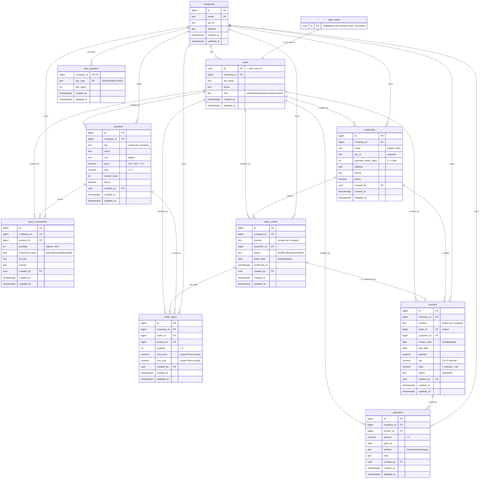

# ER diagram

The real tables of the Siam Bean Mini ERP, as created by the migrations in `supabase/migrations/` (checked against Supabase `list_tables` for the `public` schema on 20 Oct 2026: 10 tables, same columns and foreign keys). Every business table carries `company_id`, `created_by`, `created_at` and `updated_at`; `created_by` is omitted from the boxes below to keep the diagram readable, and every `created_by` points to `users`. Money columns are `numeric(12,2)`. `auth_users` is Supabase's own `auth.users` table; `users.id` is a foreign key to it with `on delete cascade`.

## View and functions

- **View `stock_on_hand`** (`security_invoker`): one row per product with `on_hand` = the sum of its `stock_movements.quantity`. There is no quantity column on `products`.
- **`next_doc_number(company_id, doc_type)`** returns `SO-0001`, `INV-0001`, `IN-0001`, `OUT-0001` or `ADJ-0001`, counting per company from `doc_counters` (ADR-0003).
- **Trigger on `stock_movements`** refuses any movement that would make On Hand negative: `Not enough stock for <SKU>`.
- **`confirm_sales_order(order_id, user_id)`** (ADR-0002) returns the new Invoice id. In one transaction it locks the order and its Products (lowest id first), refuses `Not enough stock for <SKU>` / `Add at least one line` / a non-Draft, takes the next `INV` number, writes one `sale` movement per line (`ref_doc` = the INV number, `reason` = `Sales order SO-0001`), writes the Invoice (VAT = `round(subtotal * 0.07, 2)`, Invoice Date = today in Bangkok, Due Date = date + the Customer's Payment Terms) and sets the order Confirmed.
- `record_payment` arrives with the payments ticket.
- Every table has row level security enabled with no policies; `anon` and `authenticated` have no privileges on tables, view or functions. Only FastAPI (`DATABASE_URL`) reads and writes.
